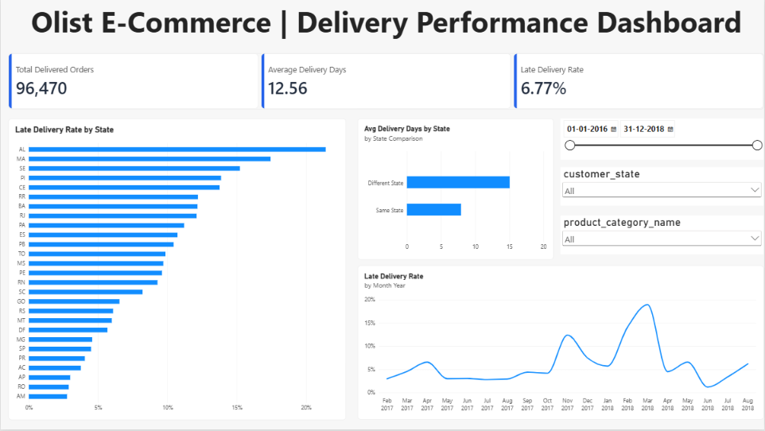
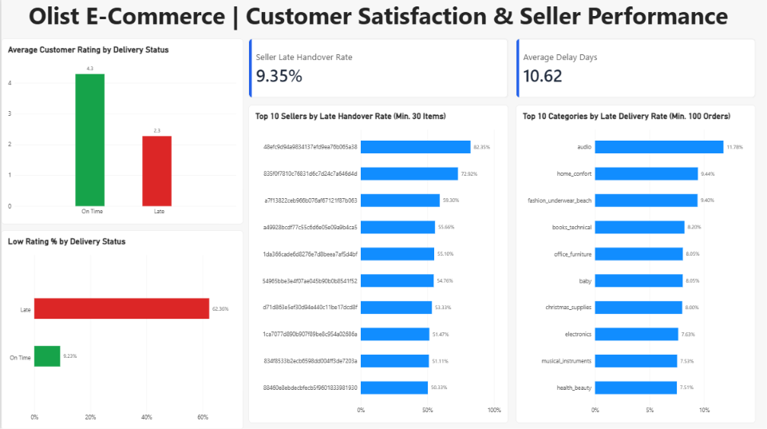

# Olist E-Commerce Delivery Performance Analysis

## Project Overview

This project presents an end-to-end data analysis of the Brazilian Olist E-Commerce dataset to evaluate delivery performance, customer satisfaction, and seller efficiency.

The analysis focuses on identifying delivery delays, understanding their relationship with customer ratings, and identifying operational areas for improvement through an interactive Power BI dashboard.

## Business Objectives

- Evaluate overall delivery performance and late delivery rates.
- Identify geographical regions with frequent delivery delays.
- Compare intra-state and inter-state delivery performance.
- Analyze monthly trends in late deliveries.
- Examine the relationship between delivery delays and customer satisfaction.
- Identify sellers with high late handover rates.
- Identify product categories with frequent delivery delays.
- Provide actionable, data-driven business recommendations.

## Tools & Technologies

| Tool | Purpose |
|---|---|
| Python | Data profiling and preprocessing |
| Pandas | Data cleaning and transformation |
| PostgreSQL | Data storage and exploratory data analysis |
| Power BI | Data modeling and interactive dashboards |
| DAX | Calculated columns, measures and KPIs |
| Git & GitHub | Version control and project documentation |

## Dataset

The project uses the publicly available Brazilian E-Commerce dataset provided by Olist, containing approximately 100,000 orders placed between 2016 and 2018.

**Dataset Source:** [Brazilian E-Commerce Public Dataset by Olist](https://www.kaggle.com/datasets/olistbr/brazilian-ecommerce)

The analysis utilizes seven related datasets:

- Orders
- Order Items
- Customers
- Sellers
- Products
- Order Reviews
- Product Category Name Translation

## Project Workflow

### 1. Data Profiling and Cleaning — Python

- Examined dataset structure and data types.
- Identified missing values and duplicate records.
- Investigated data quality issues and inconsistencies.
- Prepared datasets for further analysis.

### 2. Exploratory Data Analysis — PostgreSQL

- Analyzed delivery performance across customer states.
- Evaluated delivery duration and delay patterns.
- Compared same-state and different-state deliveries.
- Investigated customer review scores and low-rating percentages.
- Evaluated seller handover performance.
- Identified product categories with high late delivery rates.

### 3. Data Modeling — Power BI

- Established relationships between multiple tables.
- Created a calendar table for time-based analysis.
- Developed calculated columns and DAX measures.
- Implemented synchronized slicers across report pages.
- Configured visual interactions for meaningful analysis.

### 4. Dashboard Development — Power BI

Developed a two-page interactive dashboard containing 12 analytical visuals, including KPI cards, bar charts, column charts and a time-series line chart.

## Dashboard Preview

### Page 1 — Delivery Performance Dashboard

**Key metrics and visuals:**

- Total Delivered Orders
- Average Delivery Days
- Late Delivery Rate
- Late Delivery Rate by State
- Average Delivery Days by State Comparison
- Monthly Late Delivery Trend

**Interactive Filters:**

- Date Range
- Customer State
- Product Category

### Page 2 — Customer Satisfaction & Seller Performance

**Key metrics and visuals:**

- Average Customer Rating by Delivery Status
- Low Rating Percentage by Delivery Status
- Average Delay Days
- Seller Late Handover Rate
- Top 10 Sellers by Late Handover Rate
- Top 10 Categories by Late Delivery Rate

To improve the reliability of comparisons, seller rankings consider sellers with at least 30 eligible order items, while category rankings consider categories with at least 100 delivered orders.

## Key Performance Indicators

| KPI | Result |
|---|---:|
| Total Eligible Delivered Orders | 96,470 |
| Average Delivery Time | 12.56 days |
| Late Delivery Rate | 6.77% |
| Average Delay Among Late Deliveries | 10.62 days |
| Seller Late Handover Rate | 9.35% |
| Average Rating — On-Time Orders | 4.29/5 |
| Average Rating — Late Orders | 2.27/5 |
| Low Rating Percentage — On-Time Orders | 9.23% |
| Low Rating Percentage — Late Orders | 62.36% |

## Key Business Insights

### 1. Geographical Delivery Challenges

Alagoas (AL) recorded a late delivery rate of approximately 21.41%, significantly higher than the overall late delivery rate of 6.77%.

### 2. Interstate Delivery Takes Longer

Same-state deliveries took approximately 7.94 days, whereas different-state deliveries took approximately 15.13 days on average, based on order-item-level comparisons.

### 3. Delivery Delays and Customer Satisfaction

On-time orders received an average rating of 4.29 out of 5, compared with 2.27 for late orders, indicating a strong association between delivery performance and customer satisfaction.

### 4. Late Orders Receive More Negative Feedback

Approximately 62.36% of reviewed late orders received low ratings, compared with only 9.23% of reviewed on-time orders.

Low ratings were defined as an order-level average review score of 2 or below.

### 5. Seller Handover Performance

The overall seller late handover rate was 9.35%. Among sellers meeting the minimum order-item threshold, the highest late handover rate was 82.35%, highlighting an opportunity to improve seller dispatch reliability.

### 6. Product Category Performance

The audio category recorded the highest late delivery rate among categories meeting the minimum order threshold, at 11.78%.

## Business Recommendations

- **Improve Regional Logistics:** Evaluate regional fulfillment centers and distribution networks to reduce interstate delivery times.
- **Monitor Seller Performance:** Establish seller performance monitoring and investigate repeated late handovers.
- **Improve Delivery Estimates:** Use historical delivery patterns to provide more realistic estimated delivery dates.
- **Enhance Customer Communication:** Proactively notify customers about potential delivery delays.
- **Investigate High-Risk Categories:** Examine operational and logistics challenges in product categories with elevated late delivery rates.
- **Prioritize High-Delay Regions:** Focus logistics improvement efforts on states with consistently high late delivery rates.

## Repository Structure

| Folder / File | Description |
|---|---|
| python/ | Data profiling and cleaning scripts |
| SQL/ | Exploratory data analysis queries |
| PowerBI/ | Interactive Power BI report |
| Screenshots/ | Dashboard preview images |
| README.md | Project documentation |

## How to Explore the Dashboard

1. Download the Power BI file from the repository.
2. Open the file using Microsoft Power BI Desktop.
3. Explore both report pages.
4. Use the synchronized slicers to analyze specific time periods, customer states and product categories.

[Download Power BI Dashboard](PowerBI/dashboard.pbix)

## Analysis Considerations

- Delivery performance metrics exclude orders without valid delivery information.
- Customer satisfaction metrics exclude orders without review scores.
- Seller handover metrics are calculated at the eligible order-item level.
- Minimum volume thresholds are applied to seller and category rankings.
- Observed relationships represent associations and do not independently establish causation.

## Conclusion

This project demonstrates how Python, SQL and Power BI can be combined to transform raw e-commerce data into meaningful business insights.

The analysis highlights geographical delivery challenges, seller dispatch inefficiencies, and the strong association between delivery delays and customer satisfaction. These findings can support data-driven decisions to improve logistics efficiency and customer experience.

## Skills Demonstrated

Python · Pandas · Data Cleaning · Data Profiling · PostgreSQL · SQL · Exploratory Data Analysis · Data Modeling · DAX · Power BI · Data Visualization · Business Analysis · Git · GitHub
